# Duh Bike Point — Landing page

Landing page da **Duh Bike Point**, oficina de bicicletas no bairro do Limão, em São Paulo. Manutenção especializada em **Road, MTB e TT**.

Site estático (HTML, CSS e JavaScript, sem etapa de build), com efeitos 3D, animações de scroll, layout responsivo e um **CMS secreto** integrado ao Supabase. Todo o conteúdo pode ser editado sem mexer no código.

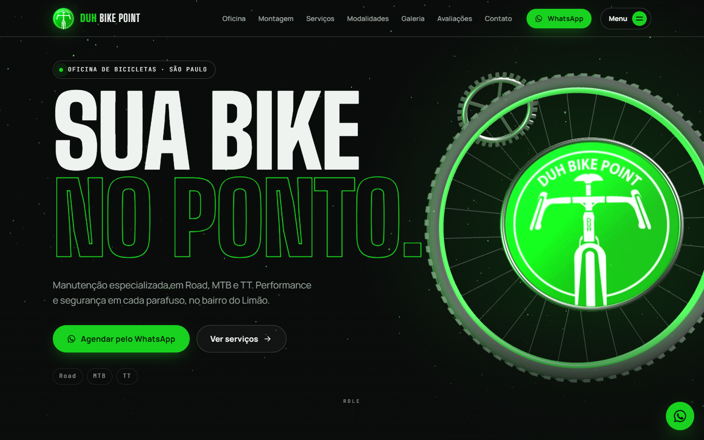

---

## Destaques

- **Hero 3D:** o logo vira uma moeda 3D dentro de uma roda de bike, com coroas e partículas. Reage ao mouse e ao scroll.
- **Bike 3D montada pelo scroll:** uma speed de carbono que se monta peça por peça (quadro, rodas, transmissão, cockpit e selim). Tem reflexos de estúdio, sombras e contador de "% montada".
- **Modalidades em pilha 3D:** cards de Road, MTB e TT que trocam conforme a rolagem. Cada card aceita uma foto de fundo.
- **Como funciona:** etapas do atendimento em rolagem horizontal, com barra de progresso.
- **Galeria em carrossel 3D:** arraste, setas, teclado e troca automática. Tocar numa foto abre a imagem em tela cheia.
- **Avaliações do Google:** nota, total de avaliações e depoimentos em carrossel.
- **Navegação:** menu em tela cheia, pontos de seção na lateral e uma barra de progresso no topo com uma bike pedalando.
- **100% responsivo:** celular, tablet e desktop, inclusive celular na horizontal. Respeita a preferência de "reduzir movimento" do sistema.
- **CMS secreto:** edita textos, títulos, listas, imagens, logo, SEO, serviços, modalidades, galeria e avaliações. Publica na hora para todos os visitantes.

## Prints

### Desktop

| | |
|---|---|
| 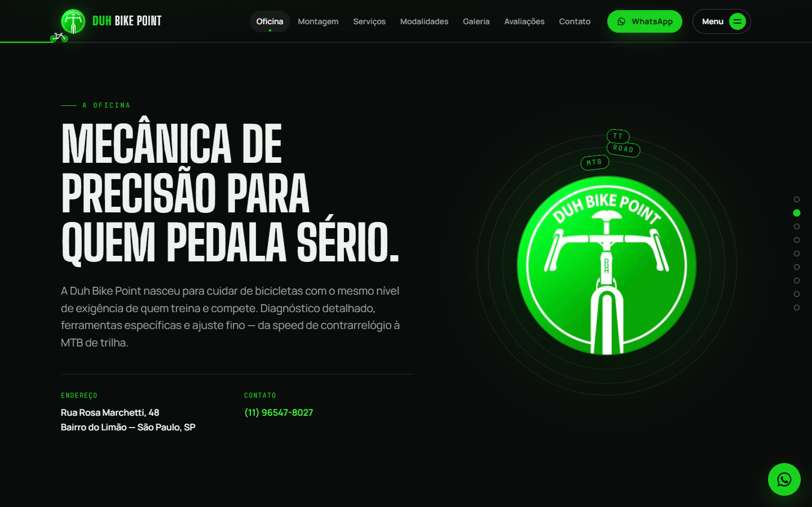 | 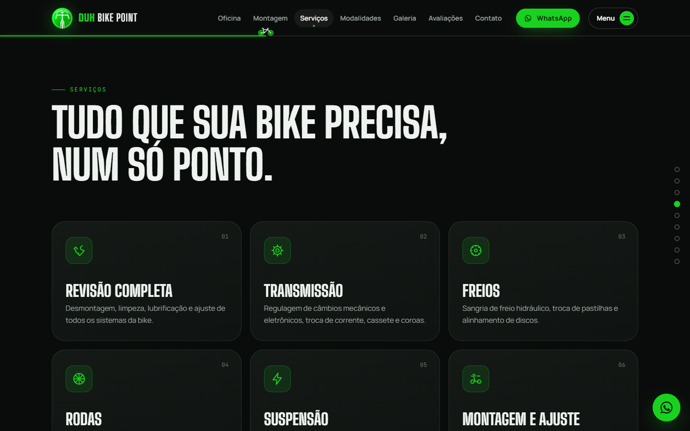 |
| **A oficina** | **Serviços** |
| 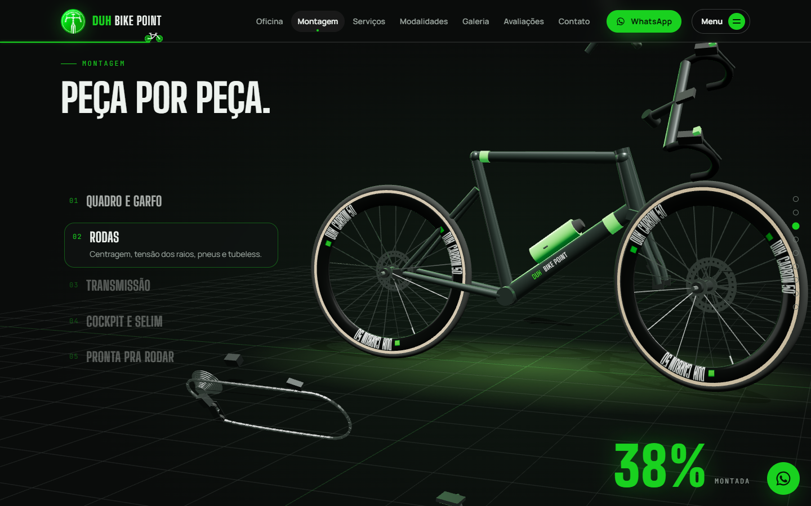 | 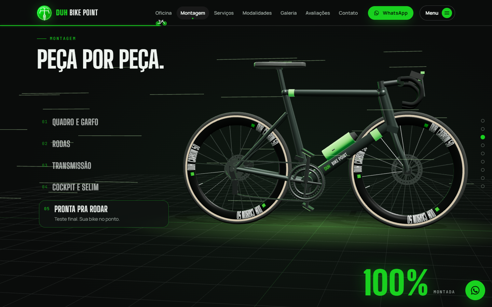 |
| **Bike 3D se montando** | **Bike 3D montada** |
| 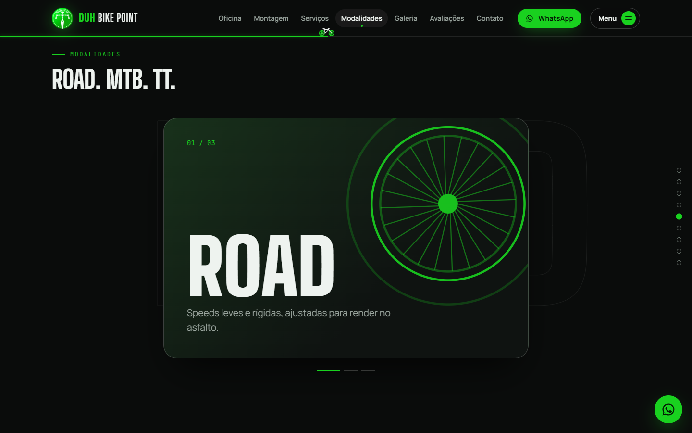 | 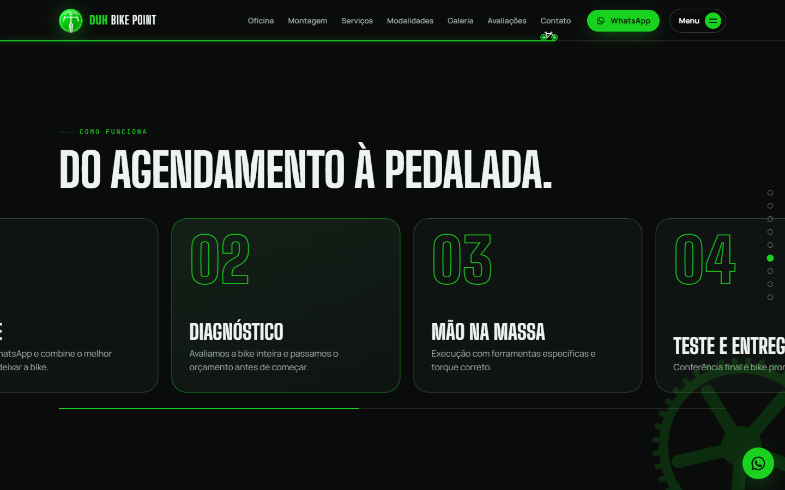 |
| **Modalidades** | **Como funciona** |
| 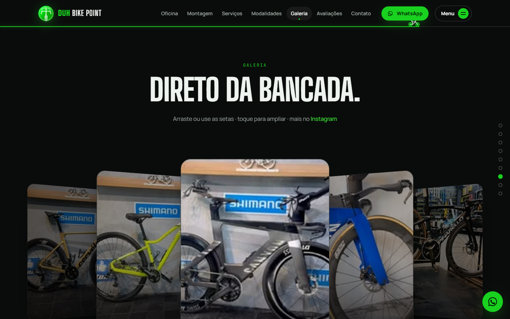 | 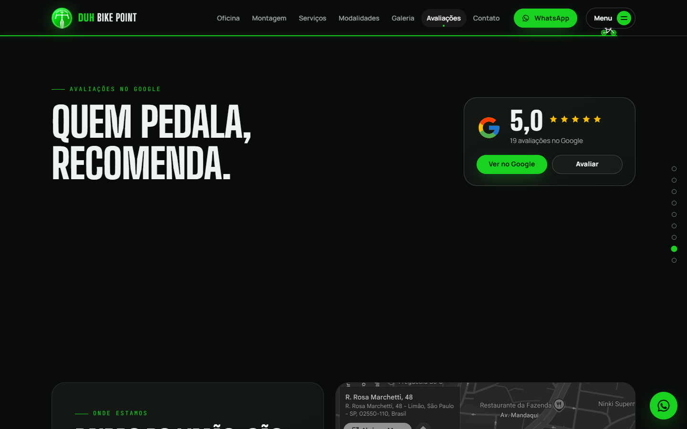 |
| **Galeria em carrossel** | **Avaliações do Google** |

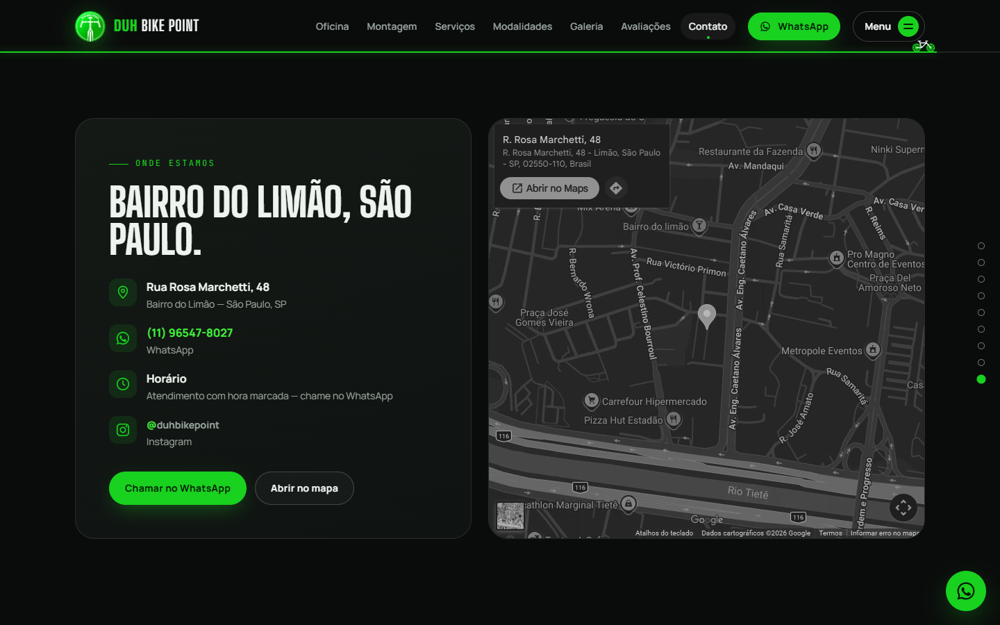

### Celular

| Início | Montagem | Modalidades | Galeria | Menu |
|---|---|---|---|---|
| 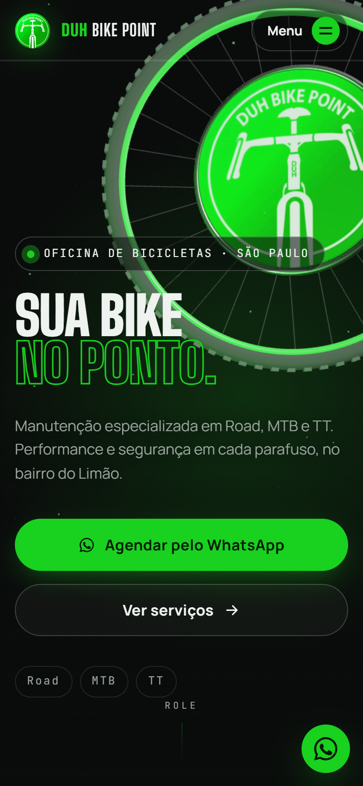 | 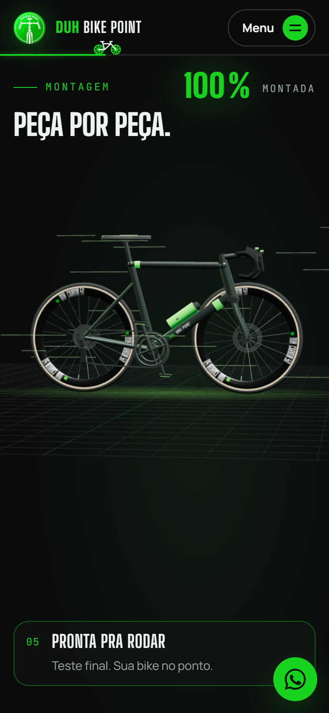 | 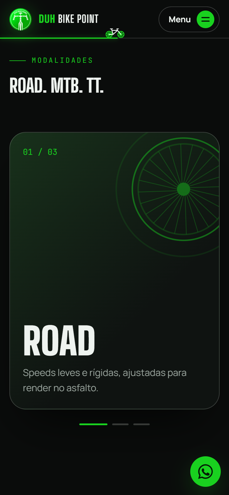 | 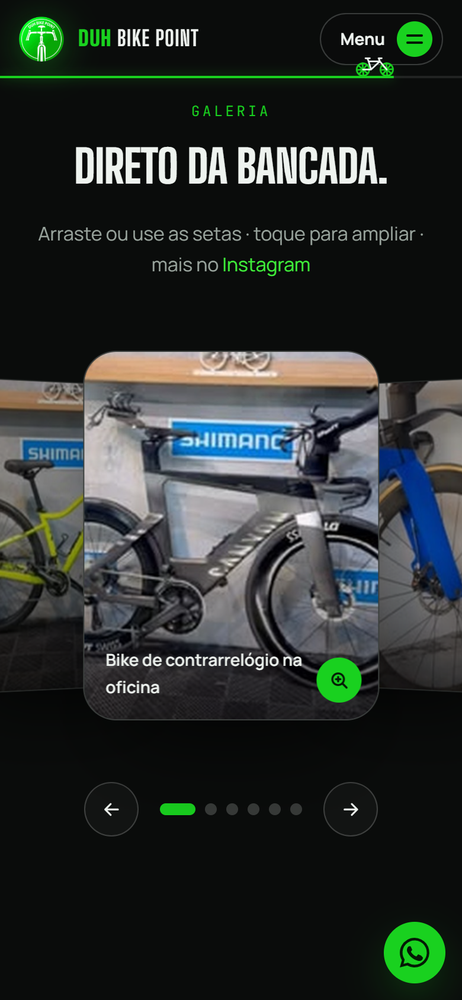 | 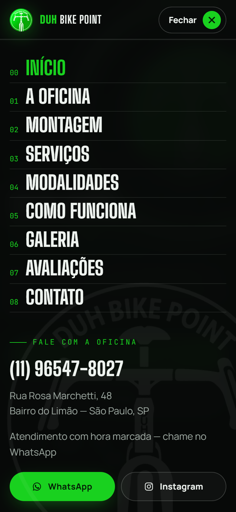 |

## Design system

| Token | Valor |
|---|---|
| Fundo (grafite) | `#0a0c0b` |
| Verde da marca | `#19d11f` |
| Texto (branco giz) | `#eef3ef` |
| Títulos | **Big Shoulders Display**, condensada e esportiva |
| Texto | **Manrope** |
| Rótulos técnicos | **JetBrains Mono** |
| Raios | 10 / 18 / 28 px e pill |

Os tokens ficam no `:root` de [`css/styles.css`](css/styles.css).

## Tecnologias

- [Three.js](https://threejs.org/) r128: hero 3D e bike 3D
- [GSAP](https://gsap.com/) + ScrollTrigger: seções fixadas e animadas pelo scroll
- [Lenis](https://lenis.darkroom.engineering/): scroll suave
- [Supabase](https://supabase.com/): banco, autenticação e armazenamento das imagens do CMS

## Estrutura

```
index.html            página
css/styles.css        design system + layout responsivo
js/config.js          conexão com o Supabase (chave pública)
js/content.js         conteúdo padrão (usado até o primeiro salvamento no CMS)
js/store.js           leitura e gravação do conteúdo
js/render.js          monta as seções a partir do conteúdo
js/hero3d.js          cena 3D do topo
js/bike3d.js          bike 3D montada pelo scroll
js/effects.js         scroll, menu, carrossel, modal de imagem e animações
js/cms.js             CMS
js/app.js             inicialização
supabase/setup.sql    tabelas, regras de segurança (RLS) e bucket de imagens
assets/               logo sem fundo, favicon e fotos
docs/screenshots/     prints deste README
```

## CMS

O site tem um **CMS secreto**, sem link visível na página. Pelo CMS dá para:

- editar todos os textos e títulos das seções, os dados de contato e o SEO;
- trocar o logo;
- adicionar, editar, reordenar e remover serviços, modalidades (com foto de fundo), etapas, fotos da galeria e avaliações;
- exportar e importar um backup em JSON.

Ao salvar, o conteúdo é publicado na hora no Supabase. Imagens trocadas ou removidas são apagadas do armazenamento automaticamente, então o banco não acumula arquivos sem uso. Leitura é pública; só administradores podem gravar, por regras de segurança (RLS) no banco.

## Rodando localmente

Qualquer servidor estático serve. Por exemplo:

```bash
python -m http.server 5520
```

Depois, abra `http://localhost:5520`.

## Publicação

Por ser estático, pode ir para Vercel, Netlify, GitHub Pages ou qualquer hospedagem de arquivos. O conteúdo vem do Supabase, então não é preciso publicar de novo para mudar textos ou imagens.

---

Duh Bike Point · Rua Rosa Marchetti, 48 · Bairro do Limão · São Paulo, SP · Instagram [@duhbikepoint](https://instagram.com/duhbikepoint)
